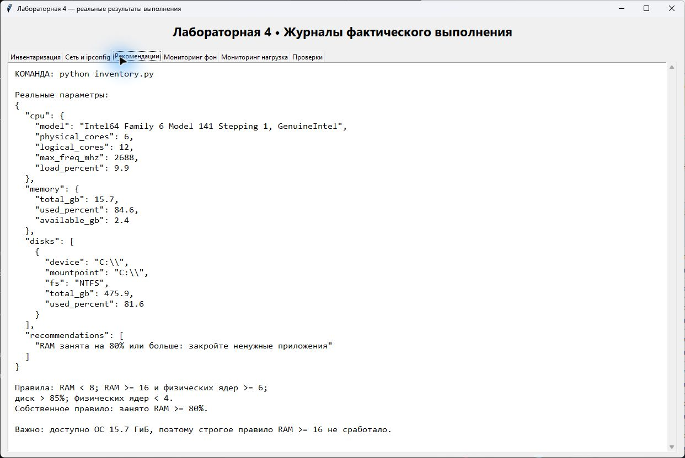
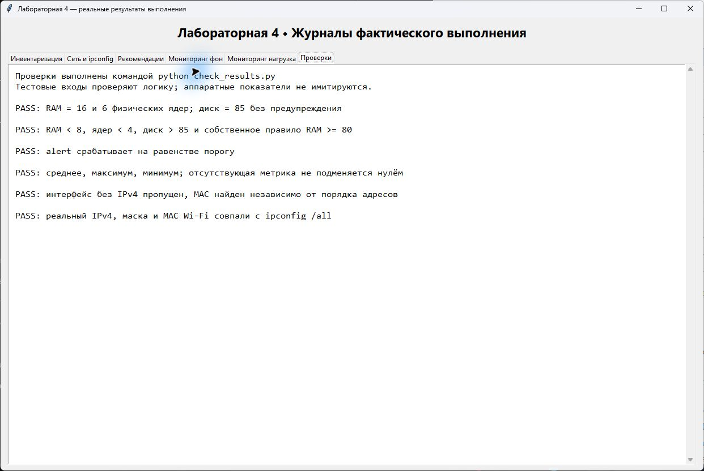

# Лабораторная работа 4 — вариант 1

**Публичная обезличенная версия отчёта.** Численные результаты взяты из выполненной работы. Идентификаторы заменены на REDACTED. Из восьми оригинальных скриншотов опубликованы только два, проверенные на отсутствие личных данных; их пиксели не изменялись. Остальные изображения, исходные Word/PDF и полный ipconfig не опубликованы.

Группа ПТ 16 30

Автоматизированная инвентаризация и мониторинг рабочей станции на Python

Вариант 1

Дата выполнения: 6 ноября 2026 года

## Цель работы

Программно собрать сведения о компьютере, сохранить технический паспорт в JSON, реализовать анализ ресурсов и мониторинг с порогами и журналом CSV.

## Результат

Созданы и запущены inventory.py и monitor.py. Получены паспорт REDACTED и два журнала по 30 измерений. Проведён эксперимент с одним потоком CPU и 512 МиБ памяти. Первым превышен порог RAM; он был превышен ещё до включения нагрузки.

| Параметр варианта | Значение |
| --- | --- |
| Интервал / число замеров | 1 с / 30 |
| Пороги CPU / RAM / DISK | 70% / 80% / 85% |
| Дополнительная метрика | Количество процессов len(psutil.pids()) |

Среда: Windows 11, Python 3.14.5, psutil 7.2.2. Все размеры в ГБ и МБ в коде рассчитаны через 1024, то есть фактически в ГиБ и МиБ.

## Задание 1 Паспорт компьютера

В отдельной папке создано виртуальное окружение Python, установлен psutil. Команда запуска: python inventory.py. Результат сохранён в passport_public.json.

| Характеристика | Результат |
| --- | --- |
| Компьютер / ОС | REDACTED / Windows 10.0.26200 |
| Физические / логические ядра | 6 / 12 |
| Память, видимая ОС | 15,7 ГиБ; занято 84,6% |
| Диск C | NTFS; 475,9 ГиБ; занято 81,6% |

Ключи верхнего уровня: collected_at, system, cpu, memory, disks, network, recommendations. Последние два ключа добавлены в заданиях 2 и 3.

## Сравнение с Windows

В Диспетчере задач занято 84% RAM, в паспорте — 84,6%. Значения близки; окна сняты не одновременно, а Диспетчер задач округляет показатель до целого процента. Загрузка CPU меняется со временем: единичные показания разных окон не обязаны совпадать.

В исходной работе текущая загрузка RAM сравнивалась с Диспетчером задач. Скриншот списка процессов исключён из публичной версии, поскольку раскрывает установленные и работающие приложения. Число ядер получено скриптом.

## Почему физических и логических ядер разное число

Физическое ядро — аппаратный вычислительный блок. Логический процессор — контекст выполнения, который видит ОС. Здесь 6 физических ядер обслуживают 12 аппаратных потоков. Это не означает двукратную скорость любой программы: ресурсы одного ядра частично общие.

## Зачем обрабатывать отказ в доступе к диску

Некоторые разделы могут быть недоступны текущему пользователю. try / except PermissionError позволяет пропустить такой раздел и продолжить сбор паспорта. В реализации дополнительно обработан OSError, например для недоступного носителя.

platform.version() возвращает внутренний номер ядра Windows; значение 10.0 не противоречит названию Windows 11. platform.processor() даёт идентификатор семейства CPU, а не обязательно торговую модель.

## Задание 2 Сетевые параметры

```python
def get_network_info():
    interfaces = []
    for name, addrs in psutil.net_if_addrs().items():
        mac = next((a.address for a in addrs if a.family == psutil.AF_LINK), None)
        for addr in addrs:
            if addr.family == socket.AF_INET:
                interfaces.append({
                    "name": name, "ipv4": addr.address,
                    "netmask": addr.netmask, "mac": mac,
                })
    return interfaces
```

MAC сначала ищется среди всех адресов интерфейса. Затем добавляются только IPv4-записи. Отсутствующий MAC, например у loopback, сохраняется как null. В main() добавлено: "network": get_network_info().

IPv4 REDACTED, маска REDACTED и MAC REDACTED совпали. Полный вывод ipconfig сохранён отдельно. Для отключённых адаптеров psutil может показывать назначенный IPv4, тогда как ipconfig сообщает об отключённой среде.

## Задание 3 Анализ паспорта

```python
def analyze(passport):
    recommendations = []
    ram = passport["memory"]["total_gb"]
    cores = passport["cpu"]["physical_cores"]
    if ram < 8:
        recommendations.append("Недостаточно памяти для виртуальных машин и Docker")
    if ram >= 16 and cores is not None and cores >= 6:
        recommendations.append("Подходит для одновременной работы нескольких VM")
    for disk in passport["disks"]:
        if disk["used_percent"] > 85:
            recommendations.append(f"Освободить место на диске {disk['device']}")
    if cores is not None and cores < 4:
        recommendations.append("Процессор может стать узким местом (bottleneck)")
    # Собственное правило: запас оперативной памяти для новых программ.
    if passport["memory"]["used_percent"] >= 80:
        recommendations.append("RAM занята на 80% или больше: закройте ненужные приложения")
    return recommendations
```

В main() добавлено: passport["recommendations"] = analyze(passport). Собственное правило предупреждает при занятости RAM от 80%.



Рисунок 4. Рекомендация, полученная из реального паспорта

Условие RAM ≥ 16 ГиБ не сработало: psutil сообщил 15,7 ГиБ памяти, доступной ОС. Значение не округлялось искусственно до 16. Предупреждений о диске и числе ядер нет.

## Задание 4 Доработка монитора

```python
INTERVAL = 1
SAMPLES = 30
THRESHOLDS = {"cpu": 70, "ram": 80, "disk": 85}
EXTRA_METRIC = "processes"
```

Дополнительный столбец processes содержит len(psutil.pids()). На Windows измеряется системный диск C:\, а не относительный корень текущего диска. Перед циклом выполняется прогрев cpu_percent().

```python
def extra_metric(name):
    if name != "processes":
        raise ValueError(name)
    return len(psutil.pids())
```

```python
def take_sample(extra):
    value = extra_metric(extra)
    return {
        "time": datetime.now().isoformat(timespec="seconds"),
        "cpu": psutil.cpu_percent(interval=None),
        "ram": psutil.virtual_memory().percent,
        "disk": psutil.disk_usage(str(DISK_PATH)).percent,
        extra: round(value, 3) if value is not None else None,
    }
```

```python
def summarize(samples, extra):
    result = {}
    for metric in ("cpu", "ram", "disk", extra):
        values = [s[metric] for s in samples if s[metric] is not None]
        result[metric] = {"mean": round(mean(values), 3), "max": max(values),
                          "min": min(values)} if values else None
    return result
```

В цикле CSV получает поля time, cpu, ram, disk, processes, alert. Список samples накапливает все замеры. После цикла summarize() вычисляет среднее, максимум и минимум каждой метрики; статистика печатается и сохраняется в JSON.

```python
samples.append(sample)
# После завершения цикла:
stats = summarize(samples, extra)
for metric, values in stats.items():
    print(f"{metric}: {values['mean']:.3f} / "
          f"{values['max']:.3f} / {values['min']:.3f}")
```

Предупреждение формируется при sample[metric] >= limit. Это включает равенство порогу. Параметр --output позволяет хранить фон и эксперимент в разных CSV, сохраняя оба результата.

## Мониторинг без дополнительной нагрузки

Команда: python monitor.py --variant 1 --output monitor_baseline.csv. Выполнено 30 замеров с шагом 1 секунда при работающих пользовательских приложениях.

| Метрика | Среднее | Максимум | Минимум |
| --- | --- | --- | --- |
| cpu | 16.263 | 28.4 | 9.9 |
| ram | 87.68 | 87.9 | 87.4 |
| disk | 81.6 | 81.6 | 81.6 |
| processes | 358.1 | 360 | 357 |

RAM превышает порог 80% уже в первом фоновом измерении. Порог CPU 70% и порог диска 85% в этом запуске не достигнуты.

## Задание 5 Эксперимент с нагрузкой

Команда: python experiment.py. Монитор работает 30 секунд. Через 5 секунд отдельно запущены один вычислительный поток и выделение памяти. Нагрузка ограничена по времени и завершается автоматически.

| Метрика | Среднее | Максимум | Минимум |
| --- | --- | --- | --- |
| cpu | 21.423 | 56.9 | 11.9 |
| ram | 85.897 | 87.3 | 84.1 |
| disk | 81.6 | 81.6 | 81.6 |
| processes | 353.533 | 356 | 350 |

Первые четыре замера до нагрузки: RAM 84,1%. При включении нагрузки RAM поднялась до 87,3%. Затем показатель снизился: параллельно продолжали работать другие приложения и механизмы управления памятью Windows.

## Результаты и объяснение эксперимента

Вместо 2 ГиБ выделено 512 МиБ: перед опытом доступно 2.51 ГиБ, поэтому сохранён запас памяти для ОС. Выделение меньше половины общего объёма RAM и четверти доступной памяти. Размер нагрузки явно отличается от примера в задании.

Подтверждение выполнения: CPU-процесс накопил 24.83 с процессорного времени; RSS процесса памяти — 524.8 МиБ. Созданные процессы остановлены после замеров. Другие процессы не завершались.

Один занятый логический процессор даёт примерно 100 / 12 = 8,3 процентного пункта общей загрузки CPU. Общая загрузка включает и другие приложения, поэтому не равна ровно 8,3% и не обязана достигать 100%. Поток может перемещаться между ядрами.

Первой порог превысила RAM: 84,1% уже в первом замере эксперимента до нагрузки. CPU достиг 56,9% при пороге 70%; диск остался на 81,6% при пороге 85%. Главный сигнал нехватки запаса ресурсов — RAM. Одно превышение само по себе ещё не доказывает причину торможения конкретной программы.

## Контрольные вопросы

## 1 Что такое IT инвентаризация и CMDB

IT-инвентаризация — учёт оборудования, ПО и их характеристик. CMDB — база данных конфигурационных единиц и связей между ними. Автоматизация ускоряет сбор сведений, уменьшает ручные ошибки и позволяет обновлять данные на множестве компьютеров.

## 2 Почему используется JSON

JSON содержит структурированные ключи и значения, которые программа легко читает и проверяет. Его удобно передавать по сети и обрабатывать автоматически. Word предназначен прежде всего для оформления документа; извлекать из него данные для агента значительно сложнее.

## 3 Чем ядро отличается от логического процессора

Ядро является физической частью CPU. Логический процессор — аппаратный контекст выполнения, доступный планировщику ОС. Благодаря SMT одно ядро может обслуживать несколько потоков, используя общие ресурсы.

## 4 Что такое порог и почему не ждать 100 процентов

Порог — значение, при достижении которого программа выдаёт предупреждение. Порог ниже 100% оставляет время отреагировать до исчерпания ресурса. Его выбирают с учётом назначения системы и характера нагрузки, а не одинаково для всех компьютеров.

## 5 Что такое bottleneck и как его найти

Узкое место — ресурс, который ограничивает выполнение задачи. Его ищут по серии измерений и реакции на контролируемую нагрузку: устойчивой загрузке CPU, дефициту RAM, очередям диска и задержкам. В данной работе первым срабатывает порог RAM; для окончательного диагноза нужны также задержки приложения и дополнительные метрики.

## 6 Почему одного замера CPU недостаточно

Один замер описывает только короткий интервал. На него влияют фоновые процессы и краткие пики. Нужны измерения во времени, среднее, максимум и связь с конкретной задачей. Загрузка в процентах не равна производительности: два разных CPU при одинаковом проценте выполняют разный объём работы.

## Проверка реализации и вывод



Рисунок 8. Проверки правил, порогов, статистики и сетевого сравнения

Проверены границы RAM 8/16/80, диска 85%, числа физических ядер, равенство порогу alert, вычисление среднего и крайних значений, пропуск интерфейса без IPv4 и поиск MAC независимо от порядка адресов. Тестовые входы применялись только для проверки логики; паспорт и CSV получены с реального компьютера.

## Вывод

Реализованы сбор паспорта JSON, сбор сетевых параметров, пять правил анализа и мониторинг варианта 1 с журналом CSV. Сетевые значения проверены по ipconfig /all; загрузка памяти сопоставлена с Диспетчером задач. Эксперимент показал превышение порога RAM до дополнительной нагрузки и рост занятости памяти при её включении.

В публичный репозиторий включены исходники, requirements.txt, README.md, паспорт, оба CSV, сводки JSON, обезличенные результаты и два проверенных скриншота. Для повторения сначала создаётся venv, затем устанавливается psutil и запускаются команды из README.
